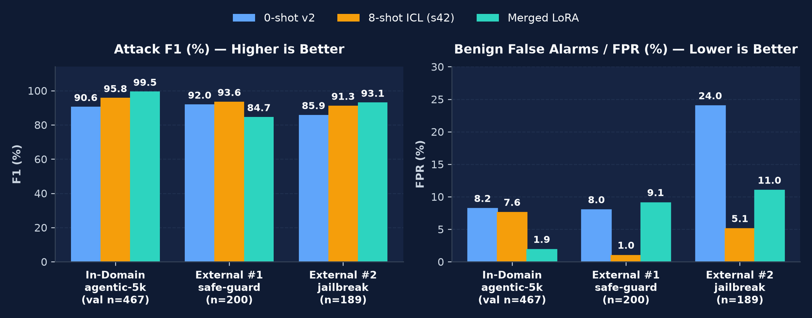

# AgentShield — Milestone 3 Addendum: T4 Reproduction, Adapter Merging Latency & External OOD Generalization

**Technical addendum | 25 November 2026**  
**Authors:** Timothy Leung, Eva Liu  
**Scope:** Independent single-epoch LoRA reproduction on NVIDIA Tesla T4 (`float16`), controlled unmerged-vs-merged (`.merge_and_unload()`) inference latency verification, and an external out-of-distribution (OOD) generalization evaluation comparing `0-shot v2`, frozen `8-shot ICL (random_seed42_8shot)`, and `Merged LoRA` on `Qwen/Qwen2.5-3B-Instruct` across public Hugging Face prompt-injection benchmarks.

> **Protocol guardrail:** None of the follow-up experiments below touch, inspect, or tune on the sealed `agentic-prompt-injection-5k` test split (`n = 545`). All training used `agentic-prompt-injection-5k` (`train` split) exclusively; external public benchmarks were strictly evaluation-only.

---

## 1. Independent GCP Tesla T4 Reproduction (1 Epoch, `float16`)

To verify reproducibility across GPU architectures/dtypes and record complete wall-clock training cost and memory metrics, we re-ran `train_lora.py` from scratch on a single **NVIDIA Tesla T4 (16 GB)** in `float16` for 1 full epoch (`491` optimizer steps over all `3,923` training rows, `batch=2`, `grad_accum=4`, `seed=42`, `lr=1e-4`, `r=8`, `alpha=16`, 7 linear target modules):

- **Wall-clock training time:** `2,454.1 s` (**40m 54s**), `1.599 samples/s`
- **Peak GPU memory:** `8.19 GB` allocated (`15.19 GB` reserved)
- **Final validation loss:** `0.00273` (`test_split_accessed: false`)

### In-Domain Validation Reproduction (`n = 467`)

| Candidate | Hardware / Dtype | Accuracy | Precision | Recall | F1 | Benign FPR |
|---|---|---:|---:|---:|---:|---:|
| M1b Base 0-shot v2 | Apple M3 Pro (`mps`) | 0.8822 | 0.9534 | 0.8636 | 0.9063 | 0.0818 |
| M2 8-shot ICL (`s42`) | Apple M3 Pro (`mps`) | 0.9443 | 0.9608 | 0.9545 | 0.9577 | 0.0755 |
| **Independent LoRA (1 ep)** | **Tesla T4 (`float16`)** | **0.9936** | **0.9904** | **1.0000** | **0.9952** | **0.0189** |
| Primary LoRA (`ckpt-491`, 1 ep) | NVIDIA A10G (`bfloat16`) | 0.9979 | 0.9968 | 1.0000 | 0.9984 | 0.0063 |

All four attack families reached **100.0% recall** (`308/308`, `0 FN`) on the T4 reproduction; the 3 benign false positives were `quoting_attack_for_analysis` (`id=655, 3172, 4544`), down from `11/12` under 8-shot ICL.

---

## 2. Engineering Finding: Adapter Merging Eliminates PEFT Latency Overhead

In the primary A10G validation run, unmerged `PeftModel` LoRA ran **62% slower** than 8-shot ICL (`0.4925 s` vs. `0.3035 s` mean latency) despite using **58% fewer input tokens** (`345.7` vs. `828.7`). Code inspection identified the root cause: `LoRADetector` kept `PeftModel` wrappers active across `252` linear layers (`36` transformer layers × `7` modules), executing ~504 extra small adapter matrix multiplications per decoded token at batch size 1.

Benchmarking `.merge_and_unload()` (`W' = W + (alpha/r) B A` folded once at model load) on 30 validation rows on the Tesla T4 (`float16`, batch size `1`):

| Mode | Exact Agreement | Mean Latency | p50 Latency | Speedup |
|---|---:|---:|---:|---:|
| Unmerged `PeftModel` | — | 0.7753 s | 0.7795 s | 1.00× |
| **Merged `.merge_and_unload()`** | **30 / 30** | **0.4036 s** | **0.4039 s** | **1.92×** |

Across external benchmarks on the same T4, merged LoRA sustained **`0.38–0.43 s` p50** per request — approximately **30% faster** than 8-shot ICL (`0.55–0.59 s` p50) while using **58% fewer prompt tokens**. We added an opt-in `--merge-adapter` flag to [`evaluate_lora.py`](scripts/evaluate_lora.py) and `merge_adapter: bool = False` to [`LoRADetector`](src/detectors/lora.py) (defaulting to `False` to preserve backwards compatibility).

---

## 3. External Out-of-Distribution (OOD) Generalization Study (Public Hugging Face Benchmarks)

Because near-perfect scores on one synthetic benchmark (`0.995–0.998` F1) do not prove cross-domain robustness, we evaluated the exact same `Qwen/Qwen2.5-3B-Instruct` base (`0-shot v2`, frozen `8-shot ICL s42`, and `Merged LoRA` — trained **only** on `agentic-prompt-injection-5k`) on public external Hugging Face prompt-injection benchmarks on Tesla T4 (`float16`):

| Benchmark | Split / Composition | Method | Accuracy | Precision | Recall | F1 | Benign FPR | p50 Latency |
|---|---|---|---:|---:|---:|---:|---:|---:|
| **`agentic-prompt-injection-5k`** *(in-domain)* | Validation (`n=467`) | 0-shot v2 *(M1b)* | 0.8822 | 0.9534 | 0.8636 | 0.9063 | 0.0818 | — |
| | | 8-shot ICL `s42` *(M2)* | 0.9443 | 0.9608 | 0.9545 | 0.9577 | 0.0755 | — |
| | | **Merged LoRA (T4)** | **0.9936** | **0.9904** | **1.0000** | **0.9952** | **0.0189** | **0.388 s** |
| **`xTRam1/safe-guard-prompt-injection`** *(External #1)* | External test (`n=200`, 100/100) | 0-shot v2 | 0.9200 | 0.9200 | **0.9200** | 0.9200 | 0.0800 | **0.354 s** |
| | | **8-shot ICL `s42`** | **0.9397** | **0.9888** | 0.8889 | **0.9362** | **0.0100** | 0.545 s |
| | | Merged LoRA | 0.8543 | 0.8989 | 0.8000 | 0.8466 | 0.0909 | 0.382 s |
| **`jackhhao/jailbreak-classification`** *(External #2)* | External test (`n=189`, 89/100) | 0-shot v2 | 0.8519 | 0.7798 | 0.9551 | 0.8586 | 0.2400 | **0.401 s** |
| | | 8-shot ICL `s42` | 0.9202 | **0.9405** | 0.8876 | 0.9133 | **0.0505** | 0.594 s |
| | | **Merged LoRA** | **0.9312** | 0.8878 | **0.9775** | **0.9305** | 0.1100 | 0.425 s |
| **`deepset/prompt-injections`** *(External #3)* | Official test (`n=116`) | 0-shot v2 | 0.6983 | 0.9630 | 0.4333 | 0.5977 | 0.0179 | — |
| | | Merged LoRA | 0.6897 | 0.9615 | 0.4167 | 0.5814 | 0.0179 | — |

*Note: Across external test runs, 0–2 malformed outputs occurred per arm on unusual external strings and were excluded from metrics rather than coerced.*

---

## 4. Root-Cause Error Analysis & Actionable Remedies

1. **In-domain specialization vs. OOD calibration trade-off.** LoRA did not fail uniformly OOD: it won F1 (`0.9305`) and Recall (`97.8%`) on `jailbreak-classification`, beating both 0-shot (`0.8586`) and 8-shot ICL (`0.9133`). However, frozen **8-shot ICL** preserved dramatically lower benign FPR on both external sets (`1.0%` on `safe-guard`, `5.1%` on `jailbreak-classification`) because its 3.1B pretrained weights remained untouched.
2. **Single-corpus shortcut learning.** Fine-tuning all 7 linear projections across every layer on one synthetic corpus drove validation loss down to `0.0027`, over-sharpening on synthetic phrasing patterns (e.g., flagging multi-sentence instructional benign prompts on `safe-guard` and `jailbreak-classification`).
3. **Label-taxonomy mismatch across public benchmarks.** `agentic-prompt-injection-5k` explicitly labels `legitimate_roleplay_request` and `quoting_attack_for_analysis` as benign (`0`), whereas `safe-guard-prompt-injection` and `deepset/prompt-injections` treat persona/roleplay prompts (e.g., *"You are CryptoMaster..."*, *"I want you to act as an interviewer"*) as attacks (`1`), explaining LoRA's `20` false negatives on `safe-guard` and the flat `~58–60%` F1 on `deepset`.

### Production Remedies (Milestones 4–5)
- **Multi-source training mixture + benign replay:** Blend agentic injections, direct jailbreaks, and diverse real-world benign emails, approvals, and code so LoRA retains ICL's cross-domain FPR calibration alongside LoRA's in-domain recall and merged speed.
- **Regularization:** Tune lower rank, fewer adapted modules, or earlier stopping against an external OOD dev slice.
- **Defense-in-depth:** Always pair a merged text classifier with task-aware context (user goal + provenance) and deterministic tool-authorization policy gates.
